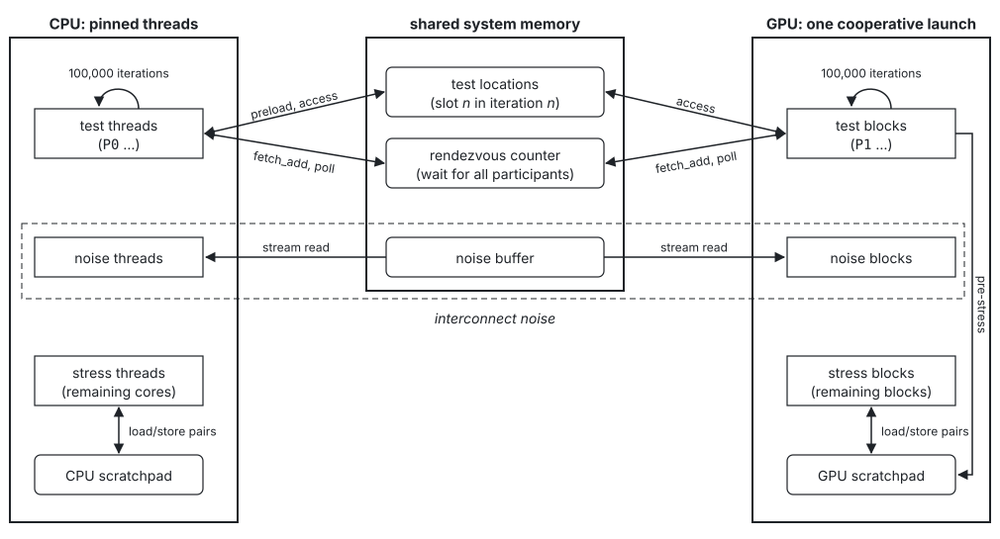

# HetLitmus

HetLitmus extends the [herdtools7](https://github.com/herd/herdtools7) litmus-testing suite to
generate, compile and run heterogeneous CPU-GPU litmus tests on real hardware. For each test
shape, it generates all distinct variants across device placements, scopes and memory orders. It
comes with 10,979 ready-made CPU-GPU tests across 29 shapes. The CPU side is AArch64 or x86_64, and
the GPU side compiles to CUDA for NVIDIA or HIP for AMD.

## Architecture

## Corpora

| Corpus | Tests | Enumeration |
|---|---|---|
| CPU-GPU with AArch64 CPU side | 6,923 | shape × device cut × GPU scope × GPU order × CPU order |
| CPU-GPU with x86_64 CPU side | 4,056 | the same enumeration |
| GPU only | 771 | shape × GPU scope × GPU order |

## DGX Spark results

[runbook.sh](https://github.com/TUM-DSE/hetlitmus/blob/main/hetlitmus/device-runs/gb10/runbook.sh)
lists the steps that reproduce the DGX Spark results reported in the thesis. For a run on another CPU-GPU system, keep the
order of the steps and adapt the commands. The raw data is in
[hetlitmus-gb10-run-data](https://github.com/lenguyenhcm325/hetlitmus-gb10-run-data).

## Upstream and license

HetLitmus is a fork of [herd/herdtools7](https://github.com/herd/herdtools7), home
<http://diy.inria.fr/>, by Jade Alglave and Luc Maranget. Upstream's build instructions are in
[INSTALL.md](./INSTALL.md).

Copyright 2010 -- present: Institut National de Recherche en Informatique et en Automatique, and
the authors. Released under the CeCILL-B free software license agreement, see
[LICENSE.txt](./LICENSE.txt).
